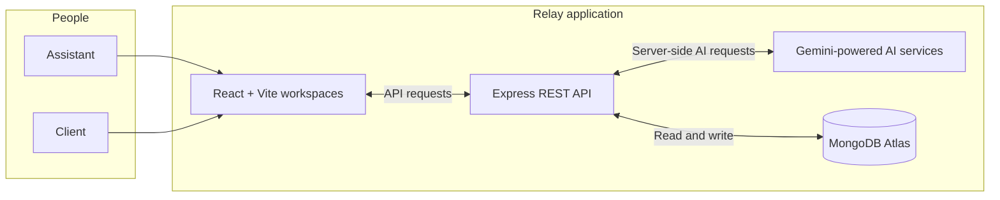

# Relay

**Turn email into clear ownership, decisions, and next steps.**

Relay is an AI-powered email workspace for executive assistants and the people they support. It helps teams understand what needs attention, who owns the next action, and what has already been taken care of.

<p>
  <a href="https://relay-virid-one.vercel.app/"><strong>Explore the live demo →</strong></a>
  &nbsp;·&nbsp;
  <a href="https://www.loom.com/share/10eb60bd54c441ba90d7db8225796d7a">Watch the product walkthrough</a>
  &nbsp;·&nbsp;
  <a href="https://github.com/SRC9060/Relay">View the source</a>
</p>

<p>
  
  
  
  
  
</p>

> **Client decides. Assistant executes.**

---

## The idea

An inbox is more than a list of messages. Behind every conversation there may be an approval, a deadline, a follow-up, or a decision that belongs to someone else.

Relay turns that complexity into a shared workflow. Instead of making both people work from the same crowded inbox, it gives each person a focused workspace—with AI assistance to surface context and make the next step easier to see.

## What you can do with Relay

### Two workspaces, one shared picture

| Assistant Workspace | Client Decision Desk |
| --- | --- |
| Review conversations by responsibility and priority | Focus on decisions that need the client's attention |
| See what needs a reply, review, or follow-up | Mark decisions as handled or delegate them back |
| Prepare context-aware reply drafts | Keep completed decisions out of the pending queue |

### AI that helps move work forward

- **Smart triage** — Organises conversations into *Assistant to Reply*, *Client to Reply*, *No Reply Needed*, and *Needs Review*.
- **Executive summaries** — Brings key updates, decisions, deadlines, and next steps into focus.
- **Context-aware reply drafts** — Creates a starting point that an assistant can review and edit.
- **Executive Copilot** — Answers natural-language questions about conversations, responsibilities, pending actions, and completed decisions using the workspace data.
- **Workflow visibility** — Search, filters, notifications, and shared status updates help keep both workspaces aligned.

## How it fits together

The interface stays focused on each person's role. The backend coordinates conversation data and calls Gemini for AI-assisted capabilities; MongoDB stores the shared workspace state.



## Built with

| Layer | Technologies |
| --- | --- |
| Frontend | React 18, Vite, React Router |
| UI & interaction | Framer Motion, Lucide React |
| Backend | Node.js, Express.js |
| Database | MongoDB Atlas, Mongoose |
| AI | Google Gemini API |

Gemini is called from the server, keeping the API key out of the browser.

## Run it locally

### Prerequisites

- Node.js 20 or later
- npm
- A MongoDB connection string for persistent shared data
- A Google Gemini API key for live Gemini-powered responses

### 1. Clone the repository

```bash
git clone https://github.com/SRC9060/Relay.git
cd Relay
```

### 2. Install dependencies

```bash
npm run install:all
```

### 3. Configure environment variables

Copy the root `.env.example` file to `.env` and set the values you need:

```env
PORT=5000
MONGODB_URI=your_mongodb_connection_string
GEMINI_API_KEY=your_gemini_api_key
```

The Gemini key is optional for trying the fallback experience. Keep real credentials in your local environment—never commit your `.env` file. For local development, leave `VITE_API_URL` unset; Vite proxies `/api` requests to the local backend.

### 4. Start the application

```bash
npm run dev
```

- **Frontend:** http://localhost:3000
- **Backend API:** http://localhost:5000
- **Health check:** http://localhost:5000/api/health

The root scripts also let you run the client and server separately with `npm run client:dev` and `npm run server:dev`.

## Run the checks

```bash
npm run client:test
npm run server:test
npm run client:build
```

## About the demo

The public demo is designed to let reviewers explore Relay's workflows using seeded sample conversations and simulated Gmail/Outlook account experiences. It does **not** connect to personal mailboxes through Gmail or Microsoft OAuth, and it does **not** send real emails.

---

**Built by [Soham Roy Chowdhury](https://github.com/SRC9060)** · [Live demo](https://relay-virid-one.vercel.app/) · [Source code](https://github.com/SRC9060/Relay)
